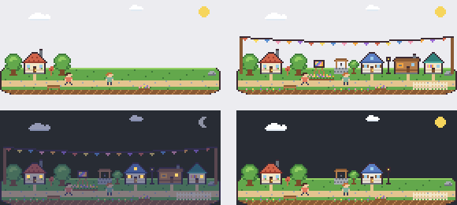

# Oddly Town

> 컴퓨터를 쓰는 동안 화면 한쪽에서 작은 마을이 살아 움직이고, 시간과 사용 패턴에 따라 조금씩 자라는 macOS 메뉴 막대 앱.

**버전:** 0.1.0-alpha · **플랫폼:** macOS 14+ (Apple Silicon 우선) · **상태:** 초기 알파 — Apple Silicon Mac에서 빌드·실행 확인



*위 이미지는 `scripts/render-art-preview.py`로 픽셀맵을 렌더링한 **에셋 프리뷰**이며 실제 앱 스크린샷이 아닙니다. 좌상: Level 1 / 우상: Level 3 + 모든 활동 시설 / 좌하: 밤 / 우하: Level 3 (활동 시설 없음).*

---

## 주요 기능 (v0.1)

- **투명 오버레이 마을**: 화면 오른쪽 아래, 테두리 없는 투명 창(기본 420×180pt). 키보드 포커스를 가져가지 않는 non-activating 패널.
- **픽셀아트 마을**: 집, 나무, 길, 주민, 구름, 우체통, 해/달/별. 모든 그래픽은 코드 안 ASCII 픽셀맵으로 직접 그린 원본입니다 (외부 에셋 없음).
- **애니메이션**: 주민이 길을 따라 걷고 멈춤, 구름 이동, 나무 흔들림(2프레임), 공방 굴뚝 연기, 축제 깃발 펄럭임, 별 반짝임.
- **낮·밤**: 실제 시각 기준 새벽/낮/해질녘/밤 색조, 저녁에 창문과 가로등 점등, 23시 이후 집 불 꺼짐.
- **3단계 성장**: 앱 실행 시간 기준. Level 2(누적 2시간) → 나무·울타리·꽃·가로등·이웃, Level 3(누적 6시간) → 파란 지붕 집·우물. **하루 최대 3시간**까지만 성장에 반영해 오래 켜두도록 유도하지 않습니다.
- **활동 기반 변화 (선택, 기본 꺼짐)**: 전면 앱을 5개 카테고리로 분류해 추정 시간을 누적.
  | 카테고리 | 마을 변화 (각 45분, 최소 레벨) |
  |---|---|
  | Development | 굴뚝 연기 나는 공방 (Lv 2) |
  | Creative | 꽃밭과 이젤 (Lv 1) |
  | Productivity | 작은 도서관 (Lv 2) |
  | Entertainment | 마을을 가로지르는 축제 깃발 (Lv 1) |
  | Other | 일반 성장에만 반영 |
- **상호작용**: 마을 클릭 → 레벨/진행률 말풍선, 드래그 → 창 이동. 메뉴 막대에서 표시/숨기기, 일시정지, 클릭 통과, 활동 감지, 상태 창, 설정, 창 위치 초기화.
- **Demo Mode (개발자 전용)**: 레벨, 낮·밤, 활동 시설을 즉시 전환. 메모리에서만 동작하고 저장되지 않습니다.

## 개인정보

- 활동 감지는 **사용자가 켜야만** 동작하며, 켤 때 수집 항목을 설명하고 동의를 받습니다.
- 저장되는 것은 **카테고리별 총 시간뿐**입니다. 앱 이름·창 제목·URL·문서·키 입력·화면은 읽거나 저장하지 않습니다.
- 사용하는 API는 `NSWorkspace` 전면 앱 알림과 "마지막 입력 후 경과 초"(`CGEventSource.secondsSinceLastEventType`, 5분 이상 자리 비움 판정용)뿐이며 Accessibility·Screen Recording·Input Monitoring 권한을 요청하지 않습니다.
- 네트워크 코드가 없습니다. 데이터는 `~/Library/Application Support/OddlyTown/`에만 저장됩니다.
- 설정 창에서 활동 기록 초기화와 마을 초기화를 할 수 있습니다.

## 기술 스택

Swift 5.9+ · AppKit(오버레이 패널, 메뉴 막대) · SpriteKit(렌더링) · SwiftUI(상태/설정 창) · Foundation `Codable` + JSON 파일 저장. 외부 의존성 없음.

**Xcode 프로젝트 대신 Swift Package를 쓰는 이유**: 손으로 만든 `.xcodeproj`는 깨지기 쉽고, 별도 도구(XcodeGen 등) 없이 Command Line Tools만으로 빌드할 수 있기 때문입니다. Xcode에서 `Package.swift`를 바로 열 수 있고, `.app` 번들은 스크립트로 만듭니다.

## 설치 및 실행 (Mac)

요구 사항: macOS 14 이상, Xcode 15 이상 **또는** Command Line Tools(Swift 5.9+). Xcode 없이 Command Line Tools만으로도 빌드됩니다 (`xcode-select --install`).

```bash
git clone <repo> oddly-town && cd oddly-town

# 1) 바로 실행 (개발용, Dock 아이콘 없음)
swift run OddlyTown

# 2) .app 번들 만들기
scripts/build-app.sh                 # → build/Oddly Town.app
open "build/Oddly Town.app"

# 개발자 모드 (Developer 메뉴, 별도 데이터 폴더, 5초 틱, 시간 60배속)
"build/Oddly Town.app/Contents/MacOS/OddlyTown" --dev
ODDLY_DEV=1 ODDLY_TIME_SCALE=120 swift run OddlyTown
```

Xcode에서: `File > Open…`으로 `Package.swift`를 열고 `OddlyTown` 스킴을 실행합니다. 개발자 모드는 스킴의 Arguments에 `--dev`를 추가하세요.

메뉴 막대의 집 아이콘(🏠)으로 모든 기능을 제어합니다. 종료는 메뉴의 **Quit Oddly Town**.

## 테스트

```bash
swift test                       # Mac
scripts/test-core-docker.sh      # Linux/Docker (공식 swift:6.0 이미지, 코어만)
```

`OddlyTownCore`(성장 엔진, 분류기, 누적기, 저장, 레이아웃 계산)는 Foundation만 사용하므로 Linux에서도 테스트됩니다. 테스트는 XCTest가 아닌 **Swift Testing**(`import Testing`)으로 작성되어 있습니다. XCTest는 Xcode 앱에만 포함되어 Command Line Tools만 있는 Mac에서는 `unable to resolve module dependency: 'XCTest'` 오류가 나기 때문입니다 (Swift 6 툴체인 필요). UI·시스템 통합은 [docs/TESTING.md](docs/TESTING.md)의 수동 체크리스트로 확인합니다.

## 개발 환경

| 환경 | 확인 내용 |
|---|---|
| Apple Silicon Mac, Command Line Tools (macOS 27 SDK) | `swift run OddlyTown` 빌드 및 실행 확인 |
| Linux (WSL2) + Docker `swift:6.0-jammy` | 코어 빌드, 테스트 36개 통과 |

코드는 Linux에서 작성되었고 Mac에서 처음 빌드할 때 macOS 전용 컴파일 오류 2건을 수정했습니다 ([CHANGELOG.md](CHANGELOG.md)).

빌드 중 `ld: warning: search path '/Library/Developer/CommandLineTools/Developer/Library/Frameworks' not found` 경고는 Command Line Tools만 설치된 환경에서 나오는 것으로, 무시해도 됩니다.

## 알려진 문제 / 미검증 사항

- [docs/TESTING.md](docs/TESTING.md)의 수동 체크리스트(클릭 통과, 드래그, 설정 창, 활동 감지, Demo Mode 등)는 아직 항목별로 확인되지 않았습니다.
- Mac에서 `swift test`와 `scripts/build-app.sh`(.app 번들)는 아직 실행되지 않았습니다.
- 성능 목표(메모리 150MB 이하, 평균 CPU 1% 이하, 15FPS)는 **아직 측정되지 않았습니다.** 측정 방법은 [docs/TESTING.md](docs/TESTING.md).
- 전체 화면 앱 위 표시(`fullScreenAuxiliary`), 다중 모니터, 투명 영역 클릭 동작은 실기기 확인이 필요합니다.
- 창 크기는 설정의 슬라이더로만 바꿀 수 있습니다(테두리 드래그 리사이즈 없음, 비율 고정 7:3).
- 앱별 분류 수정 UI 없음 — `settings.json`의 `categoryOverrides`를 직접 수정해야 합니다.
- 로그인 시 자동 실행 미구현.
- 번들 ID `com.oddlytown.OddlyTown`은 임시값입니다. 배포 전 소유한 도메인으로 바꾸세요.

## 향후 계획

[ROADMAP.md](ROADMAP.md) 참고. 구조와 데이터 흐름은 [ARCHITECTURE.md](ARCHITECTURE.md), 변경 내역은 [CHANGELOG.md](CHANGELOG.md).
